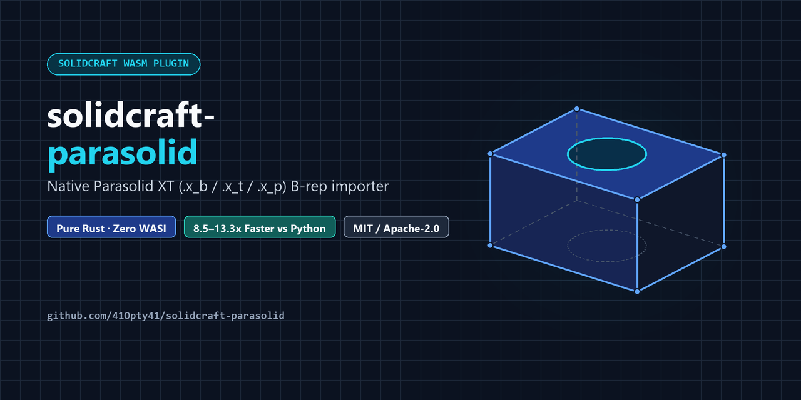

<div align="center">

<picture>
  <source media="(prefers-color-scheme: dark)" srcset="assets/logo-dark.svg">
  <source media="(prefers-color-scheme: light)" srcset="assets/logo-light.svg">
  
</picture>

<p>
  <strong>Clean-room Parasolid XT (<code>.x_b</code>, <code>.x_t</code>, <code>.x_p</code>) B-rep importer plugin for SolidCraft — written in pure Rust and compiled to WebAssembly.</strong>
</p>

<p>
  <a href="README.md">English</a> ·
  <a href="docs/i18n/README.ru.md">Русский</a> ·
  <a href="docs/i18n/README.zh-CN.md">简体中文</a> ·
  <a href="docs/i18n/README.de.md">Deutsch</a> ·
  <a href="docs/i18n/README.ja.md">日本語</a> ·
  <a href="docs/i18n/README.es.md">Español</a>
</p>

<p>
  <a href="https://github.com/41Opty41/solidcraft-parasolid/actions/workflows/ci.yml"></a>
  <a href="LICENSE-MIT"></a>
  
  
  <a href="DONATE.md"></a>
</p>



</div>

---

## Why `solidcraft-parasolid`?

[SolidCraft](https://github.com/tangency-labs/solidcraft) is a pure-Rust parametric 3D CAD application whose core stays strictly open-formats-only (`STEP`, `IGES`, `3MF`). Commercial CAD transmit files such as **Parasolid XT** (`.x_b`, `.x_t`, `.x_p`) are supported through SolidCraft's sandboxed **WebAssembly importer plugins**.

`solidcraft-parasolid` is a pure-Rust port of [xtopen](https://github.com/41Opty41/xtopen) compiled to a **`craft:plugin@0.2.0` WebAssembly Component** (`wasm32-unknown-unknown`, zero WASI imports, zero network access):

- **Opens `.x_b`, `.x_t`, `.x_p`, `.xmt_txt`, `.xmt_bin` directly** via **File › Open** in SolidCraft `v0.50.0+` (underscore extensions enabled upstream in [tangency-labs/solidcraft#22054](https://github.com/tangency-labs/solidcraft/pull/22054)).
- **Clean-room & self-contained:** built-in Parasolid XT base schema (Form-1 & Form-2 binary + text), zero proprietary CAD vendor code or external geometry kernels.
- **Exact analytic + NURBS B-rep conversion:** planes, cylinders, cones, spheres, tori, swept/spun/offset surfaces, lines, circles, ellipses, rational/non-rational NURBS, and trimmed 2D p-curves.
- **Fast:** **8.5–13.3× faster** than Python `xtopen` natively, and **65–129 ms end-to-end** inside SolidCraft's Wasmtime sandbox on typical parts.

---

## Install in SolidCraft (`v0.50.0+`)

1. Download **`solidcraft-parasolid-0.1.0.zip`** from the [Latest Release](https://github.com/41Opty41/solidcraft-parasolid/releases/latest).
2. In SolidCraft, open **Preferences › Plugins › Install plugin…** and select the `.zip` archive (or install from the community catalog).
3. Open any `.x_b`, `.x_t`, `.x_p`, `.xmt_txt`, or `.xmt_bin` model directly via **File › Open** (choose STEP `AP214` / `AP242` schema and `mm` / `m` units if needed).

---

## Verification Summary (SolidCraft `v0.50.0`)

- `cargo test --workspace`: all integration tests pass on synthetic `.x_b` and `.x_t` fixtures.
- `solidcraft-cli plugin check` (`0.50.0`): **`0` errors, `0` warnings**, zero WASI imports (`x_b, x_t, x_p, xmt_txt, xmt_bin, xb, xt`).
- `solidcraft-cli plugin test --require-cases` (`0.50.0`): **10/10** cases passed (`box.x_b`, `box.x_t`, `cylinder.x_b`, `cone_frustum.x_b`, `plate_with_hole.x_b`, `sphere.x_b`, `two_boxes.x_b`, `nurbs_sheet.x_b`, `corrupt.x_b`, `empty.x_b`), with exact solid volumes verified by SolidCraft's own geometry kernel.
- OpenCASCADE (`OCCT`) cross-check (Python `xtopen` vs Rust `xtopen-cli`): **8/8** shapes valid under `BRepCheck_Analyzer`, `0.0e+00` relative difference in volume and surface area.

---

## Benchmark: Python `xtopen` vs Native Rust vs SolidCraft WASM

Measured via [`scripts/bench_vs_python.py`](scripts/bench_vs_python.py) on synthetic Parasolid XT models:
- **Python** & **Rust Native:** in-process median latency (Parse + B-rep Extract + STEP AP214 Export, warmed up).
- **SolidCraft WASM E2E:** full `solidcraft-cli plugin test` execution time (host Wasmtime startup + sandboxed WASM conversion + design JSON handoff + SolidCraft kernel STEP import & evaluation).

| Case | Size (KB) | Python (ms) | Rust Native (ms) | Speedup | Parse | B-rep | STEP | SolidCraft WASM E2E (ms) |
|---|---:|---:|---:|---:|---:|---:|---:|---:|
| `plate_with_hole` (`.x_b`) | 5.0 | 7.666 | 0.753 | **10.2×** | 11.2× | 9.7× | 5.8× | 72.0 |
| `plate_with_hole` (`.x_t`) | 4.8 | 9.472 | 0.788 | **12.0×** | 13.7× | 10.4× | 5.6× | 76.0 |
| `nurbs_patch` (`.x_b`) | 2.8 | 5.570 | 0.418 | **13.3×** | 15.3× | 8.6× | 6.2× | 65.0 |
| 25 bodies / 150 faces (`.x_b`) | 80.2 | 113.674 | 11.183 | **10.2×** | 10.4× | 9.5× | 6.2× | 129.0 |
| 25 bodies / 150 faces (`.x_t`) | 100.0 | 138.334 | 12.162 | **11.4×** | 12.2× | 9.9× | 5.9× | 132.0 |
| 100 bodies / 600 faces (`.x_b`) | 319.3 | 395.257 | 46.755 | **8.5×** | 9.1× | 8.2× | 5.8× | 270.0 |
| 100 bodies / 600 faces (`.x_t`) | 403.2 | 497.712 | 47.890 | **10.4×** | 11.4× | 8.4× | 6.0× | 309.0 |

---

## Native CLI (`xtopen-cli`) & Build from Source

```sh
# Run unit & integration tests
cargo test --workspace

# Convert .x_b / .x_t directly on the command line
cargo run --release -p xtopen-cli -- convert model.x_b model.step --units mm --schema AP214
cargo run --release -p xtopen-cli -- inspect model.x_b
cargo run --release -p xtopen-cli -- bench model.x_b --iters 50
```

To build the WebAssembly Component plugin (`solidcraft-parasolid-0.1.0.zip`):

```powershell
# Requires Rust + wasm32-unknown-unknown + wasm-tools
.\scripts\build-plugin.ps1
solidcraft-cli plugin check .\solidcraft-parasolid
solidcraft-cli plugin test .\solidcraft-parasolid --require-cases
```

---

## Architecture

- [`crates/xtopen-core`](crates/xtopen-core/src/lib.rs) — zero-dependency pure-Rust XT parser (`xb.rs`, `xt.rs`), built-in XT schema (`schema.rs`), B-rep extractor (`model.rs`), and STEP writer (`step_writer.rs`).
- [`crates/xtopen-cli`](crates/xtopen-cli/src/main.rs) — standalone native CLI & benchmark runner.
- [`crates/solidcraft-parasolid-wasm`](crates/solidcraft-parasolid-wasm/src/lib.rs) — `craft:plugin@0.2.0` (`importer-plugin`) WebAssembly Component wrapper.
- [`solidcraft-parasolid/plugin.json`](solidcraft-parasolid/plugin.json) — SolidCraft plugin manifest & synthetic test suite.

## Support & License

Dual-licensed under **MIT** ([`LICENSE-MIT`](LICENSE-MIT)) or **Apache-2.0** ([`LICENSE-APACHE`](LICENSE-APACHE)).

If this plugin saved you time, you can support development via Bitcoin or YooMoney — see [`DONATE.md`](DONATE.md).
